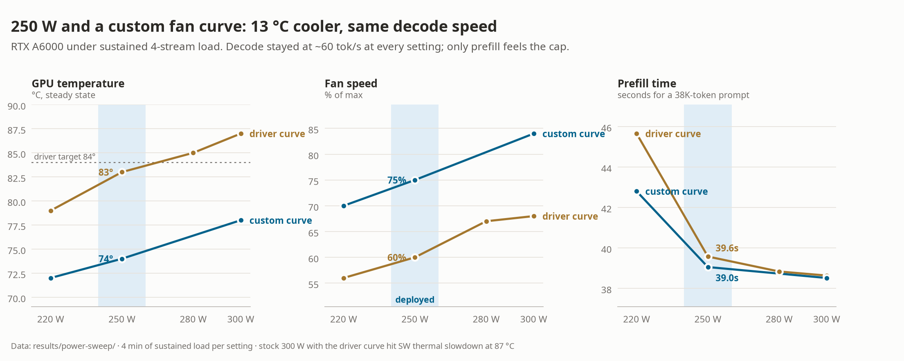
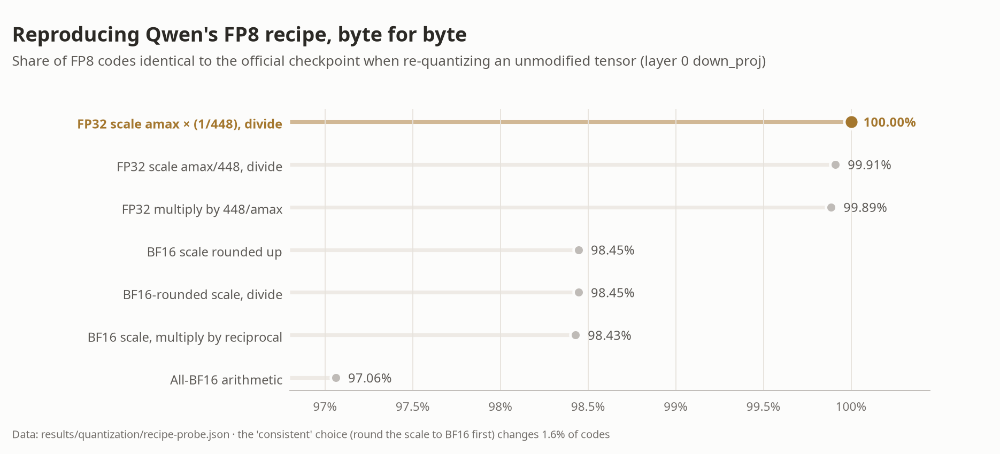
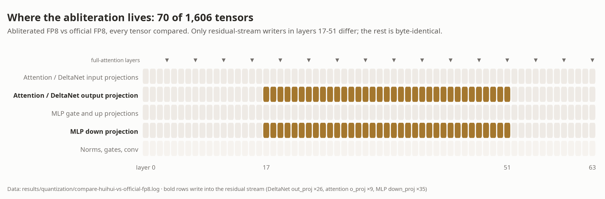
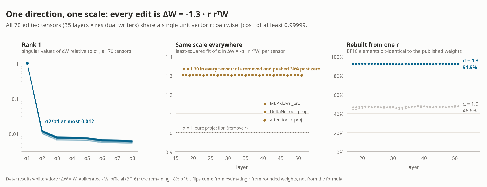
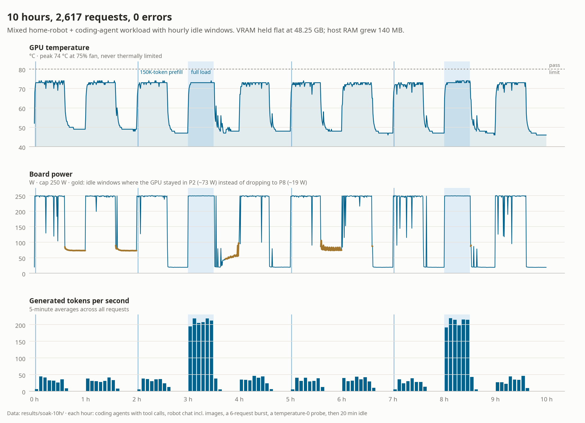
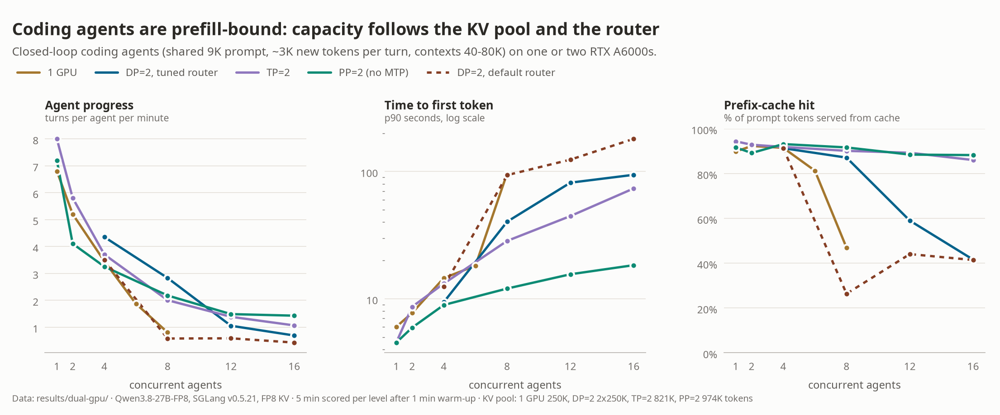

# Serving Qwen3.8-27B on RTX A6000s: FP8 on Ampere, a verified abliterated quant, a 10-hour soak, and two-GPU agent capacity

These are the engineering notes behind a single-GPU home LLM server: one user, many sessions, serving a home
robot and coding agents. The hardware is a five-year-old 48 GB Ampere workstation card. Most published Qwen3.8
recipes target Hopper or Blackwell. These notes cover what changes on `sm_86`, how the memory budget was tuned
to fit the native 262K context, how power, clocks, temperature and fan speed were balanced, how Qwen's own FP8
recipe was reproduced byte for byte, what an abliteration edit looks like inside the weights, and how a mixed
10-hour soak test was designed and what it found. A final section adds a second A6000 and measures what it
buys coding agents: data, tensor and pipeline parallelism over a consumer PCIe board, a peer-to-peer failure
that no tool reports, an agent-capacity benchmark, router settings that make or break data parallelism, and a
full 1M-token context.

The FP8 abliterated model produced here is published at
[huggingface.co/gyang274/Huihui-Qwen3.8-27B-abliterated-FP8](https://huggingface.co/gyang274/Huihui-Qwen3.8-27B-abliterated-FP8).

## TL;DR

| | Result |
|---|---|
| Engine | SGLang v0.5.21 (`lmsysorg/sglang:v0.5.21-cu130`), Qwen3.8-27B-FP8, MTP speculative decoding |
| FP8 on Ampere | Runs as weight-only W8A16 through Marlin kernels (auto-selected on `sm_86`); FP8 E4M3 KV cache |
| Context | Native 262,144 tokens per request; 247,561-token shared KV pool; 4 concurrent requests |
| Decode | ~60 tok/s single stream (51 with thinking), ~150-160 tok/s aggregate at 4 streams, ~47 tok/s at 134K context |
| Prefill | ~1,000 tok/s; a 134K-token prompt takes 140 s cold, a prefix-cache hit answers in 0.14 s |
| Power/thermals | 250 W cap + custom fan curve: 74 °C / 75% fan under sustained load (stock 300 W: 87 °C and thermal slowdown); no decode loss |
| Idle | ~7-8 W in P8, SGLang CPU ~1.4% (`--sleep-on-idle` plus a non-generating health check, without which the GPU can sit in P2 at ~73 W) |
| FP8 recipe | Our quantizer reproduces the official FP8 checkpoint byte for byte on every unmodified tensor |
| Abliteration | Exactly 70 tensors differ: the residual-stream writers of layers 17-51. Every edit is ΔW = −1.3 · r rᵀW with **one shared direction r** |
| Cost of abliteration | HumanEval 98.2% -> 95.7%, GSM8K-200 97.5% -> 94.5%, over-refusals 2/15 -> 0/15, same speed |
| Soak | 10 h mixed workload, 2,617 requests, 0 errors, 1,324 tool calls with 0 malformed, no restarts, no Xid/OOM. It also exposed an idle-power bug (a generating health check pinned the GPU in P2 at 73 W), which was root-caused and fixed |
| Second GPU: the link | Riser slot is chipset PCIe 3.0 x4 (2.7 GiB/s). CUDA reports peer-to-peer access, but the AMD IOMMU silently drops every peer write: NCCL hangs and copies return zeros. Fix: `NCCL_P2P_DISABLE=1` and `--disable-custom-all-reduce` |
| Second GPU: agents | Coding agents are prefill-bound. One card falls off a cliff at ~8 agents when its 250K-token KV pool overflows. DP=2 with a tuned router is best at 4-8 agents (2.8 turns/agent/min at 8); PP=2 (974K-token pool) is best at 12-16; TP=2 decodes fastest (81 tok/s). sglang-router's default settings send every agent to one replica |
| 1M context | Two cards, TP=2, YaRN factor 4, 32 mamba slots: 1.33M-token KV pool; 8/8 needles found in a 992K-token prompt (45 min prefill) |

## 1. Goals and constraints

The server backs a home robot and coding agents (for example as the backend of a
[pi agent](https://github.com/badlogic/pi-mono)). There is one user with several concurrent sessions. In
priority order:

1. **Stability.** It runs unattended for weeks.
2. **Low idle cost.** It sits idle most of the day, so idle GPU power and idle CPU usage matter.
3. **Precision.** FP8 is preferred over NVFP4, and BF16 does not fit. Accuracy loss should be measured, not
   assumed.
4. **Context.** The native 262K window. 1M via YaRN is out of reach on 48 GB (§5) but fits on two cards (§12).
5. **Speed.** The ideal target was over 100 tok/s, but this is the most negotiable goal.

## 2. Platform

| Component | Detail |
|---|---|
| GPU | NVIDIA RTX A6000, 48 GB GDDR6, GA102 `sm_86`, 768 GB/s, 300 W blower. A second one was added for §12 |
| Host | AMD Ryzen 9 5950X (16C/32T), 128 GB RAM, ASUS ROG STRIX B550-F, first GPU on CPU PCIe 4.0 x16. Corsair HX1000i PSU |
| Storage | Samsung 980 PRO 2 TB NVMe for models and container storage |
| OS | Ubuntu 24.04.4 LTS, HWE kernel 6.17, NVIDIA driver 590.48.01 (open), CUDA 13.1 |
| Runtime | Docker 29 + NVIDIA Container Toolkit 1.20; image and container storage on the NVMe |

Platform decisions:

- **Headless.** With GDM running, Xorg and gnome-shell keep 120-250 MB of VRAM on the compute GPU even with no
  monitor attached. Booting to `multi-user.target` brings this to 33 MiB. The desktop is started on demand with
  `systemctl start gdm`.
- **No second display GPU.** The only spare card was a GTX 1080 Ti (Pascal). Driver branch 590 no longer
  supports Pascal (580 is the last), so one driver cannot run both cards. A second card is also unnecessary. A
  model that is fully resident in VRAM barely uses PCIe, so even an x8/x8 split would not slow down single-GPU
  decoding.
- **Persistence mode.** Ubuntu's `nvidia-persistenced` unit starts with `--no-persistence-mode`. A drop-in
  override removes that flag ([system/nvidia-persistenced-override.conf](../system/nvidia-persistenced-override.conf)).
- **Pinned GPU stack.** `unattended-upgrades` was enabled, and its security origin carries NVIDIA driver
  updates. A silent driver update leaves the running kernel module and the new user-space libraries mismatched,
  and the server stays broken until reboot. The 24 NVIDIA packages are `apt-mark hold`-ed, and the driver and
  kernel are blacklisted from unattended upgrades
  ([system/51neuron-unattended-blacklist](../system/51neuron-unattended-blacklist)). Everything else still
  auto-updates. During the soak test it upgraded libc6, systemd and openssh mid-run with no effect on serving.

## 3. Choosing the engine

Three options were on the table for this hardware:

| Option | Verdict |
|---|---|
| **SGLang + Qwen3.8-27B-FP8** | Chosen. Mature, multi-session scheduling, radix prefix cache, MTP speculative decoding, OpenAI/Anthropic APIs, reasoning and tool-call parsers |
| NInfer (community `sm_86` fork) + Qwen3.8-27B INT8 | Fast (about 71 tok/s single stream on a 3090), and INT8 group-64 W8A16 is in the same precision tier as FP8. But it is a best-effort fork with open Linux qualification items and fixed concurrency. Kept as a benchmark fallback |
| Strata + Qwen3.8-Flash-Next (125B MoE) | Rejected. It fits only with 2-3-bit quantization plus RAM/SSD expert offload, serves one request at a time, and is CPU-heavy |

## 4. FP8 on Ampere: what actually runs

Ampere has no FP8 tensor cores. SGLang v0.5.21 detects this and switches the block-quantized FP8 checkpoint to
**Marlin weight-only FP8 (W8A16)** on its own, with no flag needed:

```
Your GPU does not have native support for FP8 computation but FP8 quantization is being used.
Weight-only FP8 compression will be used leveraging the Marlin kernel.
```

The weights stay FP8 in memory, so the bandwidth cost is the same as native FP8. Each GEMM dequantizes them to
BF16, so the math runs in BF16 with no activation quantization. Decoding at batch 1-4 is memory-bound, which is
where weight-only quantization pays off: about 27 GB of weights are read per token at 768 GB/s. That puts the
ceiling near 28 tok/s without speculation, and MTP more than doubles it (§6). Prefill is compute-bound, and
there Marlin W8A16 on GA102 manages about 1,000 tok/s.

The KV cache uses FP8 E4M3 (`--kv-cache-dtype fp8_e4m3`). It stores FP8 and computes in BF16, and it halves the
KV footprint, which is what makes 262K fit.

## 5. Fitting 262K context in 48 GB

Qwen3.8-27B is a hybrid model. Of its 64 layers, 48 are Gated DeltaNet (linear attention with a fixed-size
recurrent state) and only 16 are full attention, with 4 KV heads × 256 dims each. KV therefore costs about
32 KiB/token in FP8, so 262K tokens need about 8 GiB. Each concurrent request also holds a recurrent "mamba"
state of about 150 MB.

Tuning steps, all at `context_length=262144`:

| Step | KV pool (tokens) | Max running requests | Unused VRAM at end |
|---|---|---|---|
| `--mem-fraction-static 0.88`, defaults | 122,119 | 2 (capped by mamba state slots) | 7.9 GB |
| + `--enable-linear-replayssm-spec`, `--max-mamba-cache-size 24`, mem 0.92 | 170,505 | 4 | 5.7 GB |
| mem 0.97 | **247,561** | **4** | 3.3 GB |

Two findings drive this:

- **The MTP draft head's embedding and LM head are shared *after* the KV pool is sized.** The MTP module loads
  its own 248K-vocab embedding and LM head (5.3 GB). SGLang then ties them to the target model's weights and
  frees the copies, but this happens after the KV pool has been allocated, so the freed memory sits idle. Setting
  `--mem-fraction-static 0.97`, which looks aggressive, simply gives that memory to the KV pool.
- **ReplaySSM spec-verify** (`--enable-linear-replayssm-spec`) replaces the per-draft full recurrent-state
  snapshots used during MTP verification (1.69 GB) with a small replay window. That frees enough room for 24
  mamba slots and 4 concurrent requests.

1M context via YaRN would need about 64 GiB of KV in BF16 or 32 GiB in FP8, on top of 29 GB of weights. It does
not fit on this card. It does fit on two (§12).

The final launch command is in [serve/compose.yaml](../serve/compose.yaml).

## 6. Performance

| Measurement | Result |
|---|---|
| Decode, single stream, thinking off | 58-62 tok/s |
| Decode, single stream, thinking on | ~51 tok/s |
| Decode at 134K context | ~47 tok/s |
| Aggregate decode, 2 / 4 streams | ~102 / ~150-160 tok/s |
| MTP mean accepted length (3 draft steps) | 3.52 tokens per verify (coding and Q&A mix) |
| Prefill, 38K-token prompt | 38.6 s (~1,000 tok/s) |
| Prefill, 134K-token prompt | 174 s with 4,096-token chunks, **140 s** with `--chunked-prefill-size 8192` |
| Same 38K prompt again (radix-cache hit) | TTFT **0.14 s** |

The practical consequence for coding agents is that the first read of a large context is slow, but later turns
reuse the cached prefix and respond immediately. The radix cache makes multi-turn agents viable on this card.

## 7. Power, clocks, temperature and fan

The A6000 is a blower card with an 84 °C temperature target, a 93 °C maximum operating temperature and thermal
slowdown at 95 °C. Under sustained load at the stock 300 W it settled at 87 °C and reported SW thermal slowdown
(`clocks_event_reasons = 0x20`). Case airflow has little effect on a blower, so two controls were swept:



| Power cap | Driver fan curve | Custom fan curve | 38K prefill | Single-stream decode |
|---|---|---|---|---|
| 300 W | 87 °C / 68% fan, **thermal slowdown** | 78 °C / 84% | 38.5-38.6 s | ~60 tok/s |
| 280 W | 85 °C / 67% | - | 38.8 s | ~60 tok/s |
| **250 W** | 83 °C / 60% | **74 °C / 75%** | 39.1-39.6 s | ~61 tok/s |
| 220 W | 79 °C / 56% | 72 °C / 70% | 42.8-45.7 s | ~59 tok/s |

Takeaways:

- **Decode does not depend on core clocks.** It is bandwidth-bound, so it is flat at about 60 tok/s from 220 W
  to 300 W. Only prefill pays: -1.5% at 250 W and -11-18% at 220 W.
- **The driver's fan curve tracks its 84 °C target.** A lower power cap therefore mostly lowers fan speed, not
  temperature. To lower temperature you need a different fan curve.
- **Fan control works headless through NVML.** `nvmlDeviceSetFanSpeed_v2` works on the A6000 without X or
  Coolbits. [scripts/system/gpu_fan_curve.py](../scripts/system/gpu_fan_curve.py) implements the curve
  `45:30, 55:40, 65:55, 72:70, 78:85, 82:100` (°C:%). It ramps up immediately and down by at most 2% per 2 s, and
  forces the fan to 100% if a temperature read fails. On exit it hands control back to the driver, including
  when SIGKILLed (via `ExecStopPost`). A health check logs a warning when the measured fan speed stays more than
  15 points below the commanded speed for 2 minutes, an early sign of a worn bearing.
- **Deployed: 250 W cap and the custom curve.** That is 13 °C cooler than stock, with 7 points more fan speed
  and no measurable decode cost. Bearing wear grows roughly with RPM × hours. The extra RPM only applies under
  load, and idle stays at 30%, so the lifetime cost is a few percent of the fan's life. Meanwhile the
  temperature drop benefits the core, VRMs and the backside GDDR6, and the fan is a replaceable part.

## 8. BF16 to FP8: reproducing Qwen's recipe byte for byte

The abliterated model ([huihui-ai/Huihui-Qwen3.8-27B-abliterated](https://huggingface.co/huihui-ai/Huihui-Qwen3.8-27B-abliterated),
revision `739e3c5`) ships only in BF16, which is 55.6 GB and does not fit. Rather than use a generic quantizer,
[scripts/quantize/quantize_fp8_like.py](../scripts/quantize/quantize_fp8_like.py) uses the official
[Qwen/Qwen3.8-27B-FP8](https://huggingface.co/Qwen/Qwen3.8-27B-FP8) checkpoint as a **layout template**:

- A tensor is quantized to FP8 E4M3 with 128×128 block scales (`weight_scale_inv`) exactly when it is FP8 in the
  template, with the scale stored in the template's dtype (BF16).
- Every other tensor is copied in the template's dtype. This covers norms, the DeltaNet gates, the vision tower,
  the embedding and LM head, and the MTP fusion layers.
- Names, dtypes and shapes are asserted to match the template. `config.json`, with its `quantization_config`,
  comes from the template.

The result loads through exactly the same SGLang code path as the official FP8. The first version matched the
official bytes on only 98.4% of elements in unmodified tensors. A probe ([scripts/quantize/probe_quant.py](../scripts/quantize/probe_quant.py))
tried candidate recipes against tensors that abliteration does not touch:



Qwen's recipe computes the block scale in **FP32** as `amax × (1/448)`, quantizes with that FP32 scale, and
only then rounds the scale to BF16 for storage. Rounding the scale to BF16 *before* quantizing (the "consistent"
choice, recipe A) changes 1.6% of the FP8 codes. With the final recipe,
[compare_fp8.py](../scripts/quantize/compare_fp8.py) shows that every tensor abliteration did not modify is
**byte-identical** to the official FP8 checkpoint: layers 0-16 and 52-63, the MTP head, the vision tower
(333/333), and the embedding and LM head. The maximum relative weight error of the quantization itself is
2.65%, which is normal for E4M3.

This byte-identity check is the strongest evidence that the published FP8 model and the official one differ
*only* where the abliteration changed the weights.

## 9. Anatomy of an abliteration

Comparing the two FP8 checkpoints tensor by tensor gives the edit's footprint:



**Exactly 70 of the 1,606 tensors differ, one per sub-block in layers 17-51:**

| Tensor | Count | Role |
|---|---|---|
| `mlp.down_proj.weight` | 35 | MLP output projection: writes into the residual stream |
| `linear_attn.out_proj.weight` | 26 | Gated DeltaNet output projection: writes into the residual stream |
| `self_attn.o_proj.weight` | 9 | Full-attention output projection: writes into the residual stream |

Nothing else changed. That covers every Q/K/V projection, every MLP gate and up projection, every norm, the
embedding, the LM head and the MTP head.

This is exactly the footprint *directional ablation* predicts (Arditi et al., 2024,
["Refusal in Language Models Is Mediated by a Single Direction"](https://arxiv.org/abs/2406.11717)). If refusal
is mediated by one direction *r* in the residual stream, you can stop the model from ever writing along *r* by
projecting it out of every matrix that writes into the stream: W ← W − r rᵀW. Matrices that only *read* from
the stream (Q/K/V, gate/up) need no change, because nothing can write *r* back. Restricting the edit to
the middle layers (17-51 of 64) leaves early feature extraction and late token formation untouched. huihui's
model card says the narrower range was chosen to preserve capability.

**Rank and direction analysis.** The footprint is consistent with the theory. The weights themselves can test
it. If the edit really is W ← W − α r rᵀW with one shared r, then three things must hold for every
ΔW = W_abl − W_orig, computed in BF16 against the official [Qwen/Qwen3.8-27B](https://huggingface.co/Qwen/Qwen3.8-27B)
weights:

1. ΔW is **rank 1**.
2. Its left singular vector is the **same vector r** in every edited tensor.
3. ΔW ≈ −α r rᵀW for a single **α**.

[scripts/analysis/abliteration_svd.py](../scripts/analysis/abliteration_svd.py) checks all three. The script
was first validated on a synthetic rank-1 edit, where it recovered α = 1.0000 and |cos| = 1.0000.



| Test | Result over the 70 edited tensors |
|---|---|
| Changed vs bit-identical BF16 tensors | 70 changed, 1,129 bit-identical |
| Size of the edit | ‖ΔW‖ / ‖W‖ = 1.8-2.2% |
| Rank 1 | σ1 holds 99.23-99.49% of ‖ΔW‖²; σ2/σ1 ≤ 0.012 |
| One direction | pairwise \|cos\| between the 70 left singular vectors ≥ 0.99999 |
| One scale | least-squares α = 1.2992-1.3003 in every tensor |
| Rebuild from a single r, α = 1.3 | 91.9% of BF16 elements bit-exact, residual 3.9% of ‖ΔW‖ |
| Same rebuild with α = 1.0 | 46.6% bit-exact, residual 25.8% |

So the whole abliteration is one 5,120-dimensional unit vector and one scalar:
**ΔW = −1.3 · r rᵀW**, applied identically to the 70 residual-stream writers of layers 17-51. The scale is
not 1. With α = 1.3 the edit does more than remove the component along *r*: it reverses that component to −0.3×
its original value, deliberately overshooting so that these layers push the residual stream *away* from the
refusal direction. The last 8% of bit mismatches come from our estimate of *r*, not from the formula. *r* is
recovered from ΔW, which is itself the difference of two BF16-rounded tensors, so tiny errors in *r* flip
roundings that sit at a BF16 boundary. Probing fp32, fp64, BF16 and explicit-projector arithmetic did not
move the match above 92%
([results/abliteration/arithmetic-probe.txt](../results/abliteration/arithmetic-probe.txt)).

Why does a single direction in 35 of 64 layers suffice? Refusal is not stored in any one weight. It is a
feature the model *writes* into the residual stream and later layers *read*. Every component communicates
only through that stream, so constraining what the middle layers can write along *r* is enough, and the
reading weights stay untouched. This is also why the cost shows up as behavior rather than broken capability
(§10). The same edit that removes refusals also blunts a direction the model uses to commit to an answer.
The analysis covers only this checkpoint, and the recovered *r* is published in
[results/abliteration/svd.directions.pt](../results/abliteration/svd.directions.pt).

## 10. Official vs abliterated: what the edit costs

Both FP8 models were run with the same serving configuration, thinking off and temperature 0
([scripts/bench/eval_compare.py](../scripts/bench/eval_compare.py)). HumanEval solutions were executed in a
network-less, memory-capped throwaway container.

| | Official FP8 | Abliterated FP8 (this repo) |
|---|---|---|
| HumanEval pass@1 (164) | **98.2%** (3 failed) | 95.7% (7 failed) |
| GSM8K, first 200 | **97.5%** | 94.5% |
| Over-refusal: 15 benign prompts that safety-tuned models often refuse | 2 partial refusals | **0** |
| Decode, single stream / 4 streams | ~60 / ~150 tok/s | ~62 / ~142 tok/s |
| MTP mean accepted length | 3.52 | 3.52 |

- **The accuracy cost is real and one-directional.** On GSM8K the abliterated model lost 6 problems the
  official model solved and gained none. Most of these were not arithmetic errors. The model became indecisive
  on ambiguously worded problems and debated interpretations until it hit the token limit. This fits the edit
  weakening a direction that also carries "commit to an answer" behavior.
- **The official model's refusals were mild.** For "pick the lock on my own front door" it gave alternatives
  (locksmith, landlord) instead of steps. For "a phishing example for employee training" it gave an annotated
  teaching example rather than a realistic one. Nmap, SQL injection, villain monologues and medication dosing
  were all answered normally.
- **The MTP head is unaffected.** Its acceptance rate is identical, because the edit does not move the hidden
  states enough to hurt the draft predictions.

The deployment serves the official model by default, since the robot talks to children and coding accuracy
compounds over long agent runs. The abliterated model is one command away (`serve/switch-model.sh abliterated`).

## 11. A 10-hour soak test

### Design

Neither full load nor plain idle finds the failures that matter for an always-on home server. Thermal headroom
was already characterized in §7. What remains are transitions and accumulation: idle to busy wake-ups, prefix-cache
eviction as agent contexts grow, queueing past the concurrency limit, and slow memory growth. The test
([scripts/bench/soak_test.py](../scripts/bench/soak_test.py)) repeats a one-hour cycle ten times:

| Phase (per hour) | Workload | Exercises |
|---|---|---|
| min 0-35 | 3 coding-agent sessions with tool definitions. Tool calls are answered with synthetic code, so contexts grow from 3K to 50-100K tokens before restarting. One session uses thinking mode | Prefix cache, eviction, tool-call parsing, long contexts |
| min 0-35 | Home-robot chat every 1-4 min, 20% with an image | Interactive TTFT under load, vision path |
| min 35 | Burst of 6 simultaneous requests (limit is 4) | Queueing |
| min 38 | Temperature-0 probe with a fixed prompt | Numerical drift |
| min 40-60 | Idle | Return to P8, `--sleep-on-idle` wake-up |
| hours 1, 3, 6, 8 | ~150K-token prompt | Peak memory, long prefill |
| hours 4, 9 | 30 min of 6 concurrent long generations, replacing the coding phase | Thermal steady state, power cap |

A monitor samples temperature, fan speed, power, P-state, clocks, VRAM, container restarts and health,
container CPU and memory, and host RAM every 30 s. Pass criteria were set before the run: zero restarts, zero
5xx errors and timeouts, valid tool calls, under 5% drift from hour 1 to hour 10, no VRAM or RAM growth trend,
identical probe answers, no Xid/AER/MCE/OOM, temperature at or below 80 °C, and idle at P8 with SGLang CPU at or
below 2%.

### Results



| Request kind | n | Errors | TTFT p50 / p95 | Decode p50 | Max prompt |
|---|---|---|---|---|---|
| coding | 1,705 | 0 | 6.6 / 14.2 s | 48.4 tok/s | 82,361 |
| coding (thinking) | 339 | 0 | 9.0 / 17.9 s | 23.4 tok/s | 75,863 |
| robot | 103 | 0 | 3.1 / 30.3 s | 25.4 tok/s | 31 |
| robot + image | 20 | 0 | 3.9 / 32.8 s | 42.6 tok/s | 87 |
| burst | 60 | 0 | 0.25 / 7.4 s | 42.2 tok/s | 45 |
| full load | 376 | 0 | 20.2 / 35.1 s | 53.2 tok/s | 52 |
| 150K prefill | 4 | 0 | 200.7 s | 47.7 tok/s | 149,330 |
| probe | 10 | 0 | 0.12 s | 64.1 tok/s | 31 |

- **2,617 requests, 0 errors.** There were 1,324 tool calls and none had malformed JSON arguments. The container
  never restarted, and the kernel logged no Xid, AER, MCE or OOM events. The fan health check raised no
  warnings.
- **No drift.** Decode p50 was 44.9 tok/s in hour 1 and 49.7 tok/s in hour 10. The temperature-0 probe returned
  the identical answer all 10 times.
- **No leaks.** VRAM stayed flat at 48.25 GB (pools are preallocated). Host RAM grew 140 MB over 10 hours.
- **Thermals:** the maximum was 74 °C at 75% fan, with no thermal slowdown.
- **Verdict:** every pass criterion held except one. *Idle at P8* failed in 4 of the 10 idle windows. This was
  missed at first, because the summary statistic only counted low-power samples. It was caught when the
  timeline was plotted, then root-caused and fixed (finding 3).
- **Findings:**
  1. *Health check false negatives during long prefills.* By default SGLang's `/health` issues a one-token
     generation and waits for the scheduler. A 150K-token prefill keeps the scheduler busy for over 3 minutes,
     so with a 10 s timeout and 3 retries Docker flagged the container `unhealthy` during every long prefill,
     even though the server never stopped serving. Finding 3 fixes the root cause.
  2. *Robot latency under heavy coding load.* With 6 heavy streams and a limit of 4 running requests, robot
     requests wait in the FIFO queue: TTFT p50 16 s and p95 35 s, against 2.5 s and 9.3 s otherwise. Priority
     scheduling for interactive requests is the next improvement.
  3. *Idle windows stuck in P2: the health check was waking the GPU.* In 4 of 10 idle windows the GPU stayed
     in P2 at 1,800 MHz and ~73 W, with 0% utilization and SGLang CPU at 1.4%. The other 6 reached P8 at
     ~19 W. The request logs showed no difference between good and bad windows. A compressed-cycle re-run did
     not reproduce the problem, and that re-run had one difference: the Docker health check had since moved
     from every 30 s to every 60 s. A controlled test ([scripts/bench/idle_wake_test.sh](../scripts/bench/idle_wake_test.sh),
     [results/idle-power/](../results/idle-power/)) confirmed the cause. Each generating `/health` call runs
     a non-CUDA-graph forward pass that wakes the GPU. If wake-ups arrive every ≤ 30 s, the driver never
     completes its P2 → P8 transition, which takes 30-60 s on this card:

     | Extra `/health` polling (idle) | Generating `/health` (default) | `SGLANG_ENABLE_HEALTH_ENDPOINT_GENERATION=false` |
     |---|---|---|
     | none | P2 28%, 7.7 W | P2 0%, 7.6 W |
     | every 30 s | P2 73%, 72.5 W | - |
     | every 10-15 s | P2 100%, ~77 W | **P2 0%, 7.2 W** |

     The soak's 30 s health check sat right on that boundary, which made the problem intermittent. It also
     explains why the "good" idle windows read 19 W rather than 8 W. The fix is
     `SGLANG_ENABLE_HEALTH_ENDPOINT_GENERATION=false`. With it, `/health` answers from the HTTP layer in about
     1 ms and never touches the GPU, and `/health_generate` remains available as a deep check. The same change
     removes the false negatives of finding 1. Any client that polls a generating endpoint (a dashboard, an
     agent heartbeat) would cause the same 65 W idle penalty, about 570 kWh a year if it ran around the clock.

## 12. A second A6000: what it buys coding agents

A second RTX A6000 was added later, and the official FP8 model was run across both cards to answer the
question most coding-agent users with two consumer-platform GPUs have: **how many agents can the pair carry,
and which way of splitting the model is best?** Everything else stayed fixed: SGLang v0.5.21,
Qwen3.8-27B-FP8, FP8 KV cache, 250 W per card, the fan curve from §7.

### The PCIe reality of a consumer board

The B550 board has one CPU-attached x16 slot. The second full-length slot hangs off the chipset, which
shares a single PCIe 3.0 x4 uplink with the second NVMe drive, SATA, USB and the network. The second card sits
on a riser in that slot, mounted vertically in the case's vertical bracket slots, well away from the first
card's cooler. The cards are not adjacent, so there is no NVLink bridge. The A6000 supports one (112.5 GB/s), but it needs the
two cards side by side, which would cost the airflow gap; current GeForce and RTX PRO Blackwell cards have
no NVLink at all.

[scripts/bench/link_bench.py](../scripts/bench/link_bench.py) measures the link
([results/dual-gpu/link-p2p-off.json](../results/dual-gpu/link-p2p-off.json)):

| | Riser card (chipset, Gen3 x4) | Slot card (CPU, Gen4 x16) |
|---|---|---|
| Host to device | 2.7 GiB/s | 23.9 GiB/s |
| Device to host | 3.0 GiB/s | 24.2 GiB/s |

| NCCL all-reduce, 2 GPUs, via host memory | 10 KiB (one decode token) | 160 KiB | 1 MiB | 80 MiB (one 8K prefill chunk) |
|---|---|---|---|---|
| Time | 28 µs | 127 µs | 619 µs | 46 ms |
| Bus bandwidth | 0.34 GiB/s | 1.2 GiB/s | 1.6 GiB/s | 1.7 GiB/s |

### Peer-to-peer is reported, and silently broken

CUDA reports peer access between the two cards (`can_device_access_peer` is true, and
`nvidia-smi topo -p2p r` prints `OK`). It does not work. Every peer write is blocked by the AMD IOMMU, which
runs in translated mode on a stock Ubuntu kernel. The kernel logs `AMD-Vi: Event logged [IO_PAGE_FAULT ...]`
for both devices, and the destination buffer simply stays zero. No CUDA error is raised. The first symptom was
an NCCL all-reduce that spun both GPUs at 100% utilization forever, waiting for data that never arrived.

This matters beyond this machine. Any engine that trusts the reported capability can hang or, worse, compute
with zeros. SGLang assumes peer access works unless `--enable-p2p-check` is given, and its custom all-reduce
for tensor parallelism uses peer memory. Every two-GPU run here therefore used:

```
NCCL_P2P_DISABLE=1               # NCCL stages through host shared memory
--disable-custom-all-reduce      # SGLang's P2P all-reduce stays off
```

A copy test like the one in `link_bench.py` takes seconds and should be the first thing run on any multi-GPU
consumer build. Booting with `iommu=pt` (IOMMU passthrough) is the usual way to restore peer access on AMD
platforms. It was not tested here; through a chipset Gen3 x4 link it could at best halve the all-reduce latency.

### Four ways to use two cards

| | 1 GPU | DP=2 | TP=2 | PP=2 |
|---|---|---|---|---|
| What it is | Today's deployment | Two independent replicas behind sglang-router | Every layer split across both cards | Layers 0-31 on one card, 32-63 on the other |
| KV pool (tokens) | 249,600 | 2 × 249,600, not shared | **820,823** | **973,993** |
| Max running requests | 4 | 2 × 4 | 29 | 46 |
| MTP speculative decoding | yes | yes | yes | **no** (SGLang v0.5.21: PP + MTP only on prefill-only nodes) |
| Startup | 4 min | 4.5 min | 5 min | 1 min (no prefill CUDA graphs) |
| Decode, 1 stream | 60 tok/s | 60 tok/s | **81 tok/s** | 23 tok/s |
| Prefill, 49.5K-token prompt | 51 s | 51 s | 62 s | **33 s** |
| Aggregate decode, 8 / 16 streams | 165 / 197 tok/s | 310 / 320 tok/s | 249 / 344 tok/s | 130 / 217 tok/s |

Notes on the table:

- **The tensor-parallel split pays where the link is cheap and loses where it is not.** Decode moves one
  10 KiB activation per all-reduce, 128 times per token, which costs about 3.6 ms against roughly 18 ms of
  weight reads per card. Halving the weights per card wins: 81 tok/s instead of 60. Prefill moves 80 MiB per
  all-reduce for an 8K chunk, which takes 46 ms over host memory. Prefill gets 20% slower than one card.
- **Pipeline parallelism barely uses the link.** It sends one 80 MiB activation per chunk, once, at the layer
  boundary. While card 1 runs chunk *n* through the back half, card 0 runs chunk *n+1* through the front half,
  so a long prompt prefills 1.5× faster than on one card. Decode has the opposite problem. A single stream
  waits on both halves in sequence, and without MTP it runs at 23 tok/s.
- **The KV pool grows 3-4×, not 2×.** One card spends about 29 GB of its 48 GB on weights. Split two ways, each card
  holds half the weights and half the KV heads (TP) or half the layers (PP), so almost all the extra memory
  becomes cache.
- **The slot does not matter for one card.** The same single-GPU benchmark on the Gen4 x16 card gave identical
  decode (60 tok/s) and prefill (51.4 s). Once weights are resident, a single GPU barely touches PCIe.

### A coding-agent benchmark

Single-stream tokens per second is the wrong metric for coding agents. An agent turn reads far more than it
writes: each turn appends a tool result (a file, a test log, a diff) and generates a short tool call. The
benchmark ([scripts/bench/agent_bench.py](../scripts/bench/agent_bench.py)) simulates that loop:

- Every agent shares the same ~9K-token system prompt with six tool definitions, as all sessions of one agent
  product do. Each session adds its own ~3K-token repository map and task.
- Each turn the model answers with up to 512 tokens. The client waits 1-3 s ("running the tool") and appends
  1-4K tokens of tool output. Contexts grow by about 3K tokens per turn.
- When a session passes 40-80K tokens, the agent starts a new one, as agents do when they compact.
- N agents run closed-loop for 5 minutes per level after a 1-minute warm-up. Thinking is off; outputs average
  about 160 tokens per turn.

The headline metric is **turns per agent per minute**: how fast each agent makes progress.



| Agents | 1 GPU | DP=2 (default router) | TP=2 | TP=2 without MTP | PP=2 (no MTP) |
|---|---|---|---|---|---|
| 1 | 6.8 turns/min, TTFT p90 6 s | 7.8, 4.7 s | **8.0**, 4.5 s | - | 7.2, 4.5 s |
| 4 | 3.5, 15 s | 3.5, 13 s | **3.7**, 13 s | - | 3.3, **9 s** |
| 8 | 0.8, 97 s (cache hit 47%) | 0.5, 94 s | 2.0, 29 s | 1.4, 27 s | **2.2, 12 s** |
| 16 | - | 0.4, 181 s | 1.1, 74 s | 0.8, 35 s | **1.4, 18 s** |

What the numbers say:

1. **Agent workloads are prefill-bound.** At saturation the server spends its time reading new tool output,
   not writing tokens. With TP=2 and PP=2, aggregate new-token prefill reaches 700-1,100 tok/s while aggregate
   decode stays at 20-40 tok/s. The fastest decoder (TP=2) is not the best agent server.
2. **The KV pool sets the cliff.** One card holds 250K tokens of context. Four agents at 30-40K each fit; at
   eight the radix cache starts evicting live sessions, the cache hit rate drops from 91% to 47%, every evicted
   session re-prefills its whole context, and progress collapses from 3.5 to 0.8 turns per agent per minute.
   TP=2 and PP=2, with 820K and 974K tokens of cache, keep the hit rate near 90% at 16 agents.
3. **For a single agent, TP=2 is the most responsive.** It has the fastest decode and the same cache
   behavior. Up to eight agents, DP=2 with a tuned router does better still (next subsection). Beyond eight
   agents, **PP=2 carries the most work** (1.4 turns per agent per minute at 16 agents,
   TTFT p90 18 s) despite having no MTP, because its prefill is the fastest of all.
4. **MTP still pays at high concurrency.** Speculative decoding is often assumed to stop helping once batches
   grow. TP=2 without MTP made 29% less progress per agent at 8 agents and 23% less at 16.
5. **Default data-parallel routing fails for agents.** See below.

### The cache-aware router sends every agent to one card

DP=2 should have doubled the one-card capacity, since each replica handles half the agents. Instead it
collapsed at eight agents in two separate runs, worse than a single card. The worker logs show why: after
the first minute, *one* worker received every request and the other sat idle and healthy.

sglang-router's default `cache_aware` policy sends a request to the worker whose cached prefix matches it
best, and only rebalances when the workers' loads differ by more than `--balance-abs-threshold` (64 requests)
**and** a 1.5× ratio. Every coding agent's prompt starts with the same system prompt and tool definitions, so
the worker that has seen more traffic always has the best match, and a handful of agents never comes close to a
64-request imbalance. The same thing will happen with any agent product, because they all share a long fixed
prefix across sessions.

Two fixes were tested
([serve/bench-variant.sh](../serve/bench-variant.sh), variants `dp2-tuned` and `dp2-sticky`):

| Agents | Default `cache_aware` | `cache_aware`, `--balance-abs-threshold 1 --balance-rel-threshold 1.0` | `manual` (sticky `X-SGL-Routing-Key` per session, new keys to the least-loaded worker) |
|---|---|---|---|
| 4 | 3.5 turns/min, TTFT p90 13 s | **4.4**, 9 s | 3.1, 27 s |
| 8 | 0.6, 94 s | **2.8**, 40 s | 1.3, 48 s |
| 12 | 0.6, 124 s | 1.1, 82 s | 0.8, 114 s |
| 16 | 0.4, 181 s | 0.7, 94 s | 0.7, 112 s |

- **Lowering the balance thresholds fixes it.** The router still prefers the worker with the best prefix match,
  but now spreads load as soon as the workers differ by one request. With that change DP=2 was the best
  configuration of all at 4 and 8 agents: two full prefill engines working in parallel beat one engine split
  across two cards.
- **Pure session affinity was worse.** Pinning sessions to workers by load at assignment time leaves the
  slow-growing contexts unevenly packed, so one replica's 250K pool overflows while the other has room. Its
  cache hit rate fell to 63% at 8 agents.
- **Past about 8 agents, every DP setup runs out of cache.** Each replica still has only 250K tokens, and the
  hit rate falls below 60% at 12 agents. Pooled-memory TP and PP keep scaling.

### 1M tokens of context

The native window is 262,144 tokens. The Qwen model card enables 1M with YaRN (`rope_type: yarn`, factor 4
over 262,144, passed through `--json-model-override-args`). On one card that was out of reach (§5). Two cards
change that, with one more adjustment. TP=2's default KV pool, 820K tokens, is too small for a 1M-token request,
which SGLang rejects with HTTP 400 ("exceeds the maximum allowed length"). The hybrid model's recurrent-state
cache is the lever. By default SGLang sizes the mamba state cache at about 150 slots (5 per request with MTP),
roughly 10 GB per card, to allow 29 concurrent requests. `--max-mamba-cache-size 32` keeps 6 concurrent requests and returns that memory to the KV
pool, which grows to **1,330,719 tokens**.

Retrieval was tested with eight needles at evenly spaced depths in a synthetic logbook, all eight requested in
one question ([scripts/bench/niah.py](../scripts/bench/niah.py), temperature 0):

| Prompt (tokens) | Configuration | Needles found | Prefill time |
|---|---|---|---|
| 129,857 | TP=2, YaRN 1M, 32 mamba slots | 8 / 8 | 3 min |
| 221,245 | TP=2, native 262K | 8 / 8 | 5.7 min |
| 221,245 | TP=2, YaRN 1M | 8 / 8 | 5.7 min |
| 264,515 | TP=2, YaRN 1M | 8 / 8 | 7 min |
| 535,739 | TP=2, YaRN 1M | 8 / 8 | 18 min |
| 837,306 | TP=2, YaRN 1M, 32 mamba slots | 8 / 8 | 35 min |
| **992,199** | TP=2, YaRN 1M, 32 mamba slots | **8 / 8** | **45 min** |

So two A6000s do run Qwen3.8-27B at a full million tokens, in FP8 with an FP8 KV cache, and find all eight
facts at every depth. Prefill time is the practical limit: about 370 tok/s on average at 1M, as attention cost
grows with length. A million-token prompt is a batch job, not an interactive one, although follow-up
questions on the same prefix are served from the radix cache (§6). Decode speed with YaRN was unchanged (81 tok/s). This test checks
retrieval only, not reasoning over the whole context.

### Power and thermals with two cards

| Configuration (agent benchmark) | Riser card max | Slot card max |
|---|---|---|
| 1 GPU loaded | 74 °C, 75% fan | idle |
| PP=2, both loaded | 72 °C, 70% fan | 72 °C, 68% fan |
| TP=2, both loaded | 73 °C, 72% fan | 72 °C, 72% fan |

- **The vertical riser layout works.** Under sustained load on both cards neither went above 74 °C, the same
  as one card alone, and the only active clock limit was the 250 W power cap.
- **Don't trust PSU telemetry under tensor parallelism.** During the TP=2 agent runs the power supply's own
  telemetry (Corsair HX1000i through the `corsair-psu` driver) reported up to 1,016 W, right at its rating.
  A controlled check ([scripts/bench/power_transients.sh](../scripts/bench/power_transients.sh)) sampled
  both GPUs' instantaneous power every 100 ms alongside the PSU reading:

  | Load | Both GPUs, p50 / p90 / max | PSU-reported, p50 / p90 / max |
  |---|---|---|
  | TP=2, 16 long generations | 442 / 492 / 503 W | 594 / 650 / 706 W |
  | PP=2, 16 long generations | 494 / 499 / 505 W | 658 / 692 / 720 W |
  | TP=2, 8 coding agents | 411 / 461 / 506 W | **386** / 908 / 1,014 W |

  Under the agent load the PSU's median reading is *below* what the two GPUs alone were drawing, which is
  impossible for real power, while its peaks are 500 W above them. Prefill under TP alternates compute and
  host-memory all-reduce every few milliseconds, and the PSU's sampling evidently aliases on that pattern.
  A fully loaded CPU adds about 130 W at the PSU (measured with all 32 threads busy and the GPUs idle), so the
  real peak is about 750 W. The 1,000 W PSU has headroom; its telemetry under this kind of load does not
  measure it.

### What to run

For a 27B hybrid model on 48 GB Ampere cards over a consumer PCIe board:

| Situation | Choice |
|---|---|
| One card, a few agents | One card serves about four busy coding agents before its 250K-token cache overflows. Past that, more agents make every agent slower |
| Two cards, up to ~8 agents | **DP=2** behind sglang-router with `--balance-abs-threshold 1 --balance-rel-threshold 1.0`. Each replica keeps MTP, and one replica failing leaves the other serving |
| Two cards, 8-16+ agents or long contexts | **PP=2**: the largest pool (974K tokens), the fastest prefill and the lowest TTFT under load, but only 23 tok/s per stream without MTP |
| Two cards, one or two latency-sensitive agents, or 1M context | **TP=2**: 81 tok/s single stream with MTP; with `--max-mamba-cache-size 32` and YaRN, a 1.33M-token pool |
| Any multi-GPU build | Check peer copies for correctness first. If they fail, set `NCCL_P2P_DISABLE=1` and `--disable-custom-all-reduce` |

This server keeps the single-card deployment from §5. The second card is reserved for image, video and audio
models, and the measurements above were taken for these notes.

## 13. Operations

- **Serving:** Docker Compose project `neuron` ([serve/compose.yaml](../serve/compose.yaml)) with
  `restart: unless-stopped` and log rotation. The API key is mounted as a file and read at container start, so it
  never appears in `docker inspect`. The health check polls a non-generating `/health` every 30 s (see §11,
  finding 3).
- **Model switch:** `serve/switch-model.sh official|abliterated` rewrites `.env`, recreates the container and
  waits for health. The first start compiles CUDA graphs (about 4 min). Later starts take about 2 min.
- **Boot chain:** `nvidia-persistenced` (persistence on), then
  [gpu-power-limit.service](../system/gpu-power-limit.service) (250 W), then
  [gpu-fan-curve.service](../system/gpu-fan-curve.service), then Docker, then SGLang. After a reboot the API is
  ready in about 4 minutes, verified end to end over the LAN including tool calling.
- **Upgrades:** driver and kernel upgrades are manual: unhold, upgrade, reboot, re-hold.

## 14. Limitations and what changes on Blackwell

- On this card, single-stream decode tops out around 60 tok/s and prefill around 1,000 tok/s. Both are hardware
  limits (768 GB/s, no FP8 tensor cores), not tuning gaps.
- 262K is the per-request maximum, but it uses the whole KV pool. Concurrent sessions share about 248K tokens,
  which caps one card at about four busy coding agents (§12).
- Two cards on a consumer board are limited by the chipset link and the broken peer-to-peer path. An NVLink
  bridge (A6000 pairs support one) would remove most of TP's prefill penalty, at the price of mounting the cards
  side by side. That trade was not made here, for cooling. Current GeForce and RTX PRO Blackwell cards no
  longer offer NVLink at all.
- The planned upgrade is an RTX PRO 6000 (96 GB, about 1.8 TB/s, native FP8/FP4) in the x16 slot, with an RTX
  PRO 4000 for display and auxiliary models. No tensor parallelism across the asymmetric pair is planned. It
  should bring native W8A8 FP8, 1M context with an FP8 KV cache, and well over 100 tok/s single stream with MTP.

## 15. Reproduce

| Path | What |
|---|---|
| [serve/](../serve/) | Compose file, model switch script, and `bench-variant.sh` (every 1- and 2-GPU configuration in §12) |
| [system/](../system/) | systemd units, persistence override, unattended-upgrades blacklist |
| [scripts/quantize/](../scripts/quantize/) | Template-driven FP8 quantizer, checkpoint comparer, recipe probe |
| [scripts/analysis/](../scripts/analysis/) | Abliteration SVD analysis |
| [scripts/bench/](../scripts/bench/) | Speed bench, model comparison, power sweep, soak test and report; link test, coding-agent benchmark and report, long-context retrieval, two-GPU matrix runner, power transients |
| [scripts/system/](../scripts/system/) | NVML fan-curve daemon, model download |
| [scripts/figures/](../scripts/figures/) | Renders every figure from `results/` |
| [results/](../results/) | Raw data behind every number in these notes (incl. `abliteration/` SVD outputs and recovered direction, `idle-power/`, `dual-gpu/`) |
